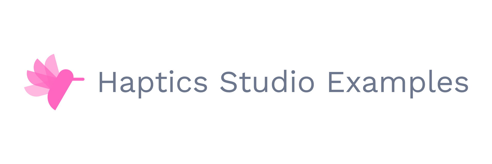

| | |
| :--- | :--- |
| **Haptics Studio** | [Overview](https://github.com/basslet/haptics-studio) · [Design & Integration](https://github.com/basslet/haptics-studio/blob/main/docs/design-and-integration/README.md) · [Source Code](https://github.com/basslet/haptics-studio/blob/main/docs/building.md) · [Architecture](https://github.com/basslet/haptics-studio/blob/main/docs/architecture.md) |
| **Haptics SDK** | [Overview](https://github.com/basslet/haptics-sdk) · [Getting Started](https://github.com/basslet/haptics-sdk/blob/main/docs/getting-started.md) · [Documentation](https://github.com/basslet/haptics-sdk/blob/main/docs/README.md) |
| **Haptics Studio Examples** | **▸ Overview** · [Guidelines](1%20Design%20Guidelines/README.md) · [Examples](2%20Design%20Examples/README.md) · [Code](3%20Integration%20%26%20Code%20Snippets/README.md) · [Knowledge](4%20Knowledge%20Base/README.md) · [Skills](5%20Skills/README.md) |
| **General** | [Code of Conduct](CODE_OF_CONDUCT.md) · [Contributing](CONTRIBUTING.md) · [License](LICENSE) · [Security](SECURITY.md) |

<picture>
  <source media="(prefers-color-scheme: dark)" srcset="./assets/logo-dark.png">
  <source media="(prefers-color-scheme: light)" srcset="./assets/logo-light.png">
  
</picture>

# Haptics Studio Examples

Haptic design guidance, sample projects and integration examples for [Haptics Studio](https://github.com/basslet/haptics-studio) and the [Haptics SDK](https://github.com/basslet/haptics-sdk).

> **Placeholder.** This repository is being built. Its pages mark where content goes, and a maintainer fills them.

## What Is Here

| Section | Holds |
| :--- | :--- |
| [Design Guidelines](1%20Design%20Guidelines/README.md) | Haptic design guidance for each platform, longer guides and worked examples |
| [Design Examples](2%20Design%20Examples/README.md) | Audio files and `.hasp` project files |
| [Integration & Code Snippets](3%20Integration%20%26%20Code%20Snippets/README.md) | Code, samples and `.haptic` files |
| [Knowledge Base](4%20Knowledge%20Base/README.md) | Platforms, capabilities and actuator types |
| [Skills](5%20Skills/README.md) | Skills for coding agents |

## Getting Started

> **Placeholder.** How to get this repository and open its projects, once there are projects to open.

## License

Copyright (c) Haptics Studio Examples contributors. Except for the [Code of Conduct](CODE_OF_CONDUCT.md), this project is under the [Creative Commons Attribution 4.0 International License](LICENSE) (CC BY 4.0). You can share and adapt it for any purpose, including commercial work, under the license's terms. Patent and trademark rights are not included.

When you share it, credit it: name Haptics Studio Examples and any author listed in the file's **Sources** row, link to this repository, say it is under [CC BY 4.0](https://creativecommons.org/licenses/by/4.0/), and say if you changed anything. A line in your documentation or in a game's credits is a good place for this. The [license](LICENSE) has the full conditions.

See [Contributing](CONTRIBUTING.md) for what can be added.

## The Haptics Projects

[Haptics Studio](https://github.com/basslet/haptics-studio): design haptics · [Haptics SDK](https://github.com/basslet/haptics-sdk): play them in your app · [Haptics Studio Examples](https://github.com/basslet/haptics-studio-examples): sample projects and design guidance
